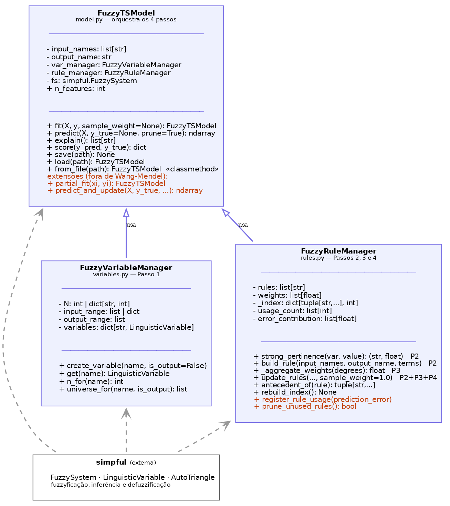

# fuzzyTSmodel

Geração automática de regras fuzzy a partir de dados, pelo método de **Wang-Mendel**,
aplicada a previsão de séries temporais.

Num sistema fuzzy clássico as regras vêm de um especialista. Aqui elas são **extraídas
dos dados**: cada amostra gera uma regra, as regras recebem um peso, e os conflitos são
resolvidos pelo maior peso. O resultado é um modelo que prevê *e* se explica — a base de
regras é legível:

```
IF (y_k_menos_1 IS B2) AND (y_k_menos_2 IS B3) AND (y_k_menos_3 IS B4) THEN (y_k IS B1)
```

O pacote é uma camada sobre a [simpful](https://github.com/aresio/simpful), que cuida da
inferência fuzzy propriamente dita.

## Instalação

```bash
git clone https://github.com/LAII-UFPB/fuzzyTSmodel.git
cd fuzzyTSmodel
```

Com [uv](https://github.com/astral-sh/uv) (recomendado):

```bash
uv venv
uv pip install -e .
```

Ou com pip:

```bash
python -m venv .venv && source .venv/bin/activate   # no Windows: .venv\Scripts\activate
pip install -e .
```

Extras opcionais: `-e ".[gui]"` instala o PyQt6 (janelas interativas do matplotlib) e
`-e ".[dev]"` instala pytest e jupyter.

## Exemplo mínimo

```python
import numpy as np
from fuzzytsmodel import FuzzyTSModel

serie = np.sin(np.arange(0, 8 * np.pi, 0.02))
X = np.vstack([np.roll(serie, lag) for lag in (1, 2, 3)]).T[3:]
y = serie[3:]

model = FuzzyTSModel(
    input_names=["lag1", "lag2", "lag3"],
    output_name="y",
    N=6,                      # 2*6+1 = 13 regiões por variável
    input_range="auto",       # faixa derivada dos dados
    output_range="auto",
)
model.fit(X[:600], y[:600])

y_pred = model.predict(X[600:], prune=False)
print(model.score(y_pred=y_pred, y_true=y[600:]))
print(model.explain()[:3])    # as regras aprendidas
```

## As classes

O pacote tem três classes, cada uma responsável por uma parte do método.

| Classe | Para que serve | Passos do método |
|---|---|---|
| `FuzzyVariableManager` | Divide o domínio de cada variável em `2N+1` regiões triangulares e as nomeia (`S_N … S1, CE, B1 … B_N`). Guarda as variáveis linguísticas criadas. | Passo 1 |
| `FuzzyRuleManager` | Guarda a base de regras. Gera a regra de cada amostra, calcula seu peso e resolve conflitos entre regras de mesmo antecedente. | Passos 2, 3 e 4 |
| `FuzzyTSModel` | Classe que você usa. Orquestra as outras duas, monta o sistema simpful e expõe `fit`, `predict`, `explain`, `score`, `save`/`from_file`. | todos |

### `FuzzyTSModel` — principais métodos

| Método | O que faz |
|---|---|
| `fit(X, y, sample_weight=None)` | Aprende a base de regras. `X` tem shape `(n_amostras, n_variaveis)` e `y`, `(n_amostras,)`. `sample_weight` é o grau de importância *m(i)* de cada amostra. |
| `predict(X, prune=False)` | Infere a saída para cada linha de `X`. |
| `explain()` | A base de regras, como lista de strings legíveis. |
| `score(y_pred, y_true)` | MAE, MAPE, RMSE e R². |
| `save(path)` / `FuzzyTSModel.from_file(path)` | Salva e recarrega o modelo completo (regras, pesos e hiperparâmetros). |

### Principais parâmetros

| Parâmetro | Significado |
|---|---|
| `input_names`, `output_name` | Nomes das variáveis. A ordem de `input_names` define a ordem das colunas de `X`, e esses nomes aparecem nas regras. |
| `N` | Granularidade: cada variável vira `2N+1` regiões. `int` para todas, ou `dict` `{nome: N}` para granularidade diferente por variável. |
| `input_range`, `output_range` | `[min, max]` do universo de discurso. Aceita `dict` `{nome: [min, max]}` por variável, ou `"auto"` para derivar dos dados em `fit()`. |
| `aggregation_fun` | Como combinar os graus de pertinência no peso da regra: `"product"` (padrão, como nos slides), `"min"`, `"max"`, `"arit_mean"` ou um callable. |

## O método, passo a passo no código

**Passo 1 — dividir os espaços de entrada e saída em regiões fuzzy.**
`FuzzyVariableManager.create_variable` cria `2N+1` triângulos uniformes sobre o universo
de discurso. Com `N=2`: `S2, S1, CE, B1, B2`.

**Passo 2 — gerar uma regra para cada amostra.**
Para cada variável, `FuzzyRuleManager.strong_pertinence` escolhe a região de **maior grau
de pertinência** naquele valor. Essas regiões, juntas, formam a regra.

**Passo 3 — atribuir um peso a cada regra.**
`_aggregate_weights` multiplica os graus de pertinência. Para os graus `0.8`, `0.7` e `0.9`,
o peso é `0.8 × 0.7 × 0.9 = 0.504`. Se houver confiança diferente entre as medições, o
`sample_weight` de `fit` multiplica esse valor.

**Passo 4 — resolver conflitos e redundâncias.**
Duas amostras diferentes podem gerar o mesmo antecedente com consequentes diferentes.
Nesse caso **fica a regra de maior peso**. É por isso que 628 amostras viram ~40 regras:
a base é uma compressão dos dados, não uma cópia.

## Como usar nos seus dados

Comece por `examples/02_seus_dados.py`, que é um template comentado.

**Formato.** `X` com shape `(n_amostras, n_variaveis)` e `y` com `(n_amostras,)`. Para uma
série temporal, as entradas são os valores passados:

```python
N_LAGS = 3
X = np.vstack([np.roll(serie, lag) for lag in range(1, N_LAGS + 1)]).T[N_LAGS:]
y = serie[N_LAGS:]
```

Para dados já separados (ex.: temperatura e vento → chuva), use as colunas direto, sem lags.

**Escolhendo N.** Comece em 5–7. `N` baixo gera poucas regras e um modelo mais suave;
`N` alto captura mais detalhe, com risco de decorar ruído. O número de regras possíveis
cresce como `(2N+1)^n_variaveis`, então aumentar `N` com muitas entradas fica caro rápido.

**Divisão treino/validação.** Em série temporal, corte por posição — não embaralhe.

**Armadilhas:**
- Variáveis em escalas diferentes precisam de faixas diferentes. Use
  `input_range={"temperatura": [0, 40], "vento": [0, 15]}` ou `"auto"`; uma faixa única
  para todas só funciona se as escalas forem parecidas.
- Valores fora do `input_range` do treino caem na região da ponta e a previsão degrada.
- MAPE é indefinido quando `y_true` passa por zero. O `score` ignora esses pontos, mas
  prefira MAE ou RMSE em séries que cruzam o zero.
- Se uma combinação de entradas nunca apareceu no treino, não existe regra para ela.

## Extensões, além de Wang-Mendel

O método original é só o `fit` + `predict` acima. O pacote traz ainda, como extensões
de pesquisa:

- **Poda de regras** (`prune_*`): remove regras pouco usadas e de baixo impacto no erro
  ao longo das predições. Ativa por padrão em `predict`; use `predict(X, prune=False)`
  para uma predição que não altera a base.
- **Aprendizado incremental** (`partial_fit`): atualiza a base com uma amostra nova.
- **Reaprendizado durante a predição** (`predict_and_update`): prevê em blocos e chama
  `partial_fit` quando o erro passa de um limiar.
- **Limite de regras** (`max_rules`): quando a base enche, a regra mais fraca dá lugar
  a uma mais forte.

## Testes

```bash
uv pip install -e ".[dev]"
pytest
```

## Diagrama de classes



## Referências

Wang, L.-X. e Mendel, J. M. "Generating fuzzy rules by learning from examples".
*IEEE Transactions on Systems, Man and Cybernetics*, v. 22, n. 6, 1992.

## Licença

MIT. Veja [LICENSE](LICENSE).
